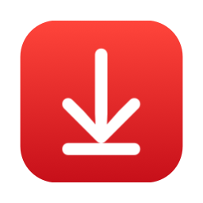
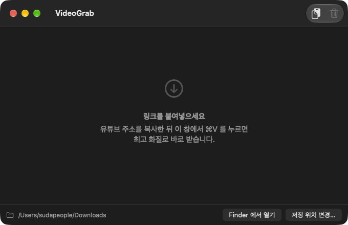
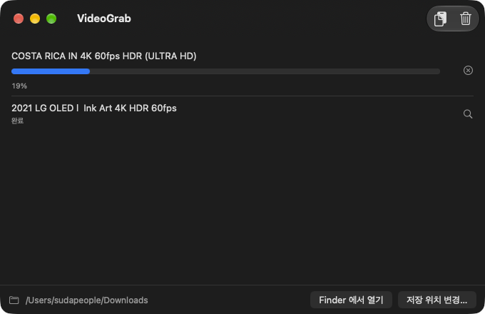

# VideoGrab

[](https://github.com/sudapeople/videograb/releases/latest)
[](https://github.com/sudapeople/videograb/releases/latest)
[](https://github.com/sudapeople/videograb/releases)
[](LICENSE)<br>
[](#내려받기)
[](#빌드설치)
[](src/VideoGrab.swift)
[](https://github.com/yt-dlp/yt-dlp)
[](#필요한-것)
<br>
[](https://github.com/sudapeople/videograb/stargazers)
[](https://github.com/sudapeople/videograb/forks)
[](https://hits.sh/github.com/sudapeople/videograb/)
[](https://github.com/sudapeople/videograb/commits/main)
[](https://github.com/sudapeople/videograb/issues)
[](src)<br>
[](https://discord.gameboy.kr)
[](https://www.youtube.com/channel/UCcm7Jc50537eMixvkVNU8-Q)
[](https://chzzk.naver.com/bcf71dbdafcdddae524d82490db546c0)
[](https://www.instagram.com/sudapeople/)
[](https://x.com/sudapeople)

한국어 | [English](#english)

유튜브·인스타그램·X 영상 링크를 복사한 뒤 창에서 `⌘V` 를 누르면 최고 화질로 바로 받는 맥 앱.
4K Video Downloader+ 의 "스마트 모드(붙여넣기 한 번에 정해진 설정으로 저장)" 만 떼어 낸 것이다.
유튜브 채널을 등록해 두면 채널 영상을 한꺼번에 받거나, 새로 올라오는 영상을 자동으로 받는다.

- 화질 : 항상 최고 화질 영상 + 최고 음질 오디오 (`bv*+ba/b`). 4K·8K·HDR·60fps 그대로
- 파일명 : 영상 제목 그대로 (`제목.mp4`). 인스타그램·X 는 제목이 서로 겹쳐서 `제목 [영상ID].mp4`
- 저장 위치 : 창 아래 "저장 위치 변경…" 으로 바꾼다. 기본값 `~/Downloads`
- 컨테이너 : mp4 (코덱은 원본 그대로, 다시 인코딩하지 않는다)

| 처음 화면 | 받는 중 |
|---|---|
|  |  |

## 내려받기

[최신 릴리스](https://github.com/sudapeople/videograb/releases/latest) 에서 `VideoGrab-버전-arm64.zip` 을 받는다.
macOS 14 이상, Apple Silicon (M1 이상).

1. 압축을 풀고 `VideoGrab.app` 을 응용 프로그램 폴더로 옮긴다
2. 받기 도구를 설치한다 (아래 "필요한 것" 참고)

```bash
brew install yt-dlp ffmpeg deno
```

3. 공증(notarization)을 받지 않은 앱이라 처음 열 때 macOS 가 막는다. 둘 중 하나로 연다
   - 시스템 설정 > 개인정보 보호 및 보안 에서 "그래도 열기"
   - 터미널에서 `xattr -dr com.apple.quarantine /Applications/VideoGrab.app`

## 사용법

1. 브라우저에서 유튜브 영상, 인스타그램 릴스·영상, X 영상 글의 주소를 복사한다 (주소창, 공유 버튼, 글 속 링크 모두 됨)
2. VideoGrab 창에서 `⌘V` (또는 툴바의 붙여넣기 버튼)
3. 끝나면 돋보기 버튼으로 Finder 에서 파일을 바로 연다

그 밖의 동작

- 클립보드에 링크가 여러 개면 모두 동시에 받는다
- `watch?v=...&list=...` 처럼 재생목록이 붙은 링크도 그 영상 하나만 받는다
- 이미 받은 파일이 있으면 다시 받지 않고 바로 "완료" 로 표시한다
- 취소하면 받던 조각(`.part`)은 남는다. "다시 받기" 를 누르면 이어서 받는다
- 링크가 없으면 경고음만 난다
- 그 밖에 yt-dlp 가 지원하는 사이트(치지직, 트위치 등)도 그대로 된다
- 인스타그램·X 에서 로그인해야 보이는 영상(비공개 계정, 성인 표시 글)은 받지 못한다

### 유튜브 채널 관리

채널은 영상 받기와 따로, "채널 관리" 창에서 다룬다. 툴바의 채널 버튼이나 `⌘2` 로 연다.

- 추가 : `+` 를 누르고 채널 주소(`youtube.com/@이름`, `youtube.com/channel/UC...`)와 저장 폴더를 정한다.
  메인 창에 채널 주소를 붙여넣어도 이 추가 창이 주소가 채워진 채로 뜬다
- 삭제 : 채널을 고르고 휴지통 버튼(또는 `delete` 키). 받은 파일은 그대로 남는다
- 저장 폴더 : 채널마다 따로 정한다. 기본값은 `저장 위치/채널 이름` 이고 언제든 바꿀 수 있다
- 새 영상 자동 받기 : 채널마다 켜고 끈다. 등록한 뒤에 올라온 영상만 받고, 등록할 때 이미 있던 영상은 받지 않는다.
  앱을 꺼 둔 사이 올라온 영상은 다음에 켤 때 받는다 (탭마다 최신 30개까지)
- 채널 영상 전체 받기 : 동영상·쇼츠·지난 라이브를 모두 차례로 받는다.
  받은 영상은 기록해 두므로 중간에 취소하고 다시 눌러도 이어서 받는다
- 방송 중이거나 예정인 라이브는 끝난 뒤 다음 확인 때 받는다

### 설정

앱 메뉴의 "설정…" (`⌘,`) 또는 툴바의 톱니바퀴.

- 저장 위치 : 주소를 붙여넣어 받는 영상을 저장하는 곳
- 새 영상 확인 : 15분, 30분(기본값), 1시간, 3시간마다 또는 "자동으로 확인 안 함"
- 받기 도구 : yt-dlp, ffmpeg, deno 가 설치되어 있는지 보여 준다

### 리소스

새 영상 자동 받기는 앱이 켜져 있는 동안에만 돌고, 쓰지 않을 때는 아무것도 돌리지 않는다.

- 뒤에 남는 프로세스가 없다. 로그인 항목이나 백그라운드 서비스를 설치하지 않고, 창을 모두 닫으면 앱이 끝난다
- 확인할 채널이 없거나 확인을 꺼 두면 타이머도 없다. 있을 때도 확인 주기마다 한 번만 깨어난다
- 새 영상은 한 번에 하나씩 받는다
- 앱을 끝내면 받고 있던 yt-dlp 와 ffmpeg 를 모두 멈춘다. 받던 조각(`.part`)은 남아서 다음에 이어 받는다
- 채널 확인에는 시간 제한(2분)이 있어, 응답 없는 서버에 매달린 프로세스가 남지 않는다

## 필요한 것

Homebrew 로 설치된 도구 3개를 쓴다. 앱 안에 넣지 않은 이유는 유튜브가 자주 바뀌어
yt-dlp 를 자주 갱신해야 하기 때문이다.

```bash
brew install yt-dlp ffmpeg deno
```

- `yt-dlp` : 유튜브 주소 해석·다운로드
- `ffmpeg` : 영상·오디오 합치기
- `deno` : 유튜브 서명 해독용 자바스크립트 실행기 (yt-dlp 가 자동으로 씀)

유튜브에서 갑자기 안 받아지면 먼저 갱신한다.

```bash
brew upgrade yt-dlp
```

## 빌드·설치

Xcode 프로젝트 없이 `swiftc` 한 번으로 빌드한다. macOS 14 이상, Apple Silicon, Swift 5.9 이상(Xcode 15 이상). Swift 6.4.2 로 시험했다.

```bash
./scripts/build.sh
```

```bash
./scripts/build.sh install
```

`install` 을 붙이면 `/Applications/VideoGrab.app` 으로 복사한다.
서명은 애드혹(`codesign -s -`)이라 이 맥에서만 쓰는 용도다.

```bash
./scripts/build.sh zip
```

`zip` 을 붙이면 릴리스에 올릴 `build/VideoGrab-<버전>-arm64.zip` 을 만들고 SHA-256 을 출력한다.
버전은 `src/Info.plist` 의 `CFBundleShortVersionString` 을 따르고,
zip 안에는 `VideoGrab-<버전>/` 폴더에 `VideoGrab.app` 과 `LICENSE` 가 들어간다.
새 버전을 낼 때는 이렇게 한다.

1. `src/Info.plist` 의 `CFBundleShortVersionString` 과 `CFBundleVersion` 을 올린다
2. `./scripts/build.sh zip`
3. `gh release create v<버전> build/VideoGrab-<버전>-arm64.zip`

## 폴더 구조

```
videograb/
├── README.md                 이 문서
├── LICENSE                   MIT 라이선스
├── docs/
│   ├── 01-4K-Video-Downloader-분석.md   원본 앱 분석 기록
│   ├── 02-설계와-검증.md                설계 결정과 시험 결과
│   ├── icon.png                         README 용 아이콘
│   ├── social-preview.png               GitHub 대표 이미지 (링크 공유 때 표시)
│   └── screenshots/                     README 용 화면
├── src/
│   ├── VideoGrab.swift       앱 전체 (SwiftUI, 약 950줄)
│   └── Info.plist
├── scripts/
│   ├── build.sh              빌드·설치·릴리스 zip
│   ├── make-icon.swift       아이콘 생성
│   └── make-social-preview.swift  대표 이미지 생성
└── build/                    빌드 산출물 (지워도 다시 만들어짐)
```

## 설정 저장 위치

설정 창의 값은 `defaults read com.sudapeople.videograb` 로 볼 수 있다
(`outputDir` 저장 위치, `checkMinutes` 새 영상 확인 주기). 값을 지우면 기본값으로 돌아간다.

등록한 채널은 `~/Library/Application Support/VideoGrab/channels.json` 에,
채널별로 받은 영상 기록은 같은 폴더의 `채널ID.txt` 에 남는다.

## 라이선스

[MIT](LICENSE). 자유롭게 쓰고 고치고 배포할 수 있다.

앱이 불러 쓰는 yt-dlp(Unlicense), FFmpeg(LGPL/GPL), Deno(MIT)는 앱에 들어 있지 않고
사용자가 Homebrew 로 따로 설치하므로 각자의 라이선스를 따른다.
영상을 받을 때는 각 서비스의 이용약관과 저작권을 지켜야 한다.

---

## English

A macOS app that downloads a YouTube, Instagram or X video in the best available quality the moment you press `⌘V` in its window.
It is a minimal take on the "Smart Mode" of 4K Video Downloader+ (paste once, save with preset settings).
Register a YouTube channel to download all of its videos, or to download new uploads automatically.

- Quality : always the best video stream + best audio stream (`bv*+ba/b`). 4K, 8K, HDR and 60fps are kept as is
- File name : the video title (`Title.mp4`). Instagram and X titles collide, so those use `Title [video id].mp4`
- Save location : change it with the "저장 위치 변경…" (Change location) button at the bottom. Default is `~/Downloads`
- Container : mp4 (original codecs, no re-encoding)

The app UI is in Korean. The documents in `docs/` are in Korean too.

### Download

Get `VideoGrab-<version>-arm64.zip` from the [latest release](https://github.com/sudapeople/videograb/releases/latest).
Requires macOS 14 or later on Apple Silicon (M1 or later).

1. Unzip it and move `VideoGrab.app` to Applications
2. Install the download tools (see Requirements below)

```bash
brew install yt-dlp ffmpeg deno
```

3. The app is not notarized, so macOS blocks it on first launch. Open it with either of these
   - System Settings > Privacy & Security, then "Open Anyway"
   - In Terminal: `xattr -dr com.apple.quarantine /Applications/VideoGrab.app`

### Usage

1. Copy the URL of a YouTube video, an Instagram reel or video, or an X post with a video (address bar, share button, or a link inside any text)
2. Press `⌘V` in the VideoGrab window (or click the paste button in the toolbar)
3. When it finishes, click the magnifier button to reveal the file in Finder

Other behavior

- Several links on the clipboard are downloaded at the same time
- A link with a playlist attached (`watch?v=...&list=...`) downloads only that one video
- If the file already exists, it is not downloaded again and is shown as done right away
- Cancelling keeps the partial file (`.part`). Press retry to resume
- If the clipboard has no link, the app just beeps
- Any other site supported by yt-dlp works too (Twitch and more)
- Instagram and X videos that need a login (private accounts, age-restricted posts) cannot be downloaded

#### YouTube channels

Channels are managed in their own window, "채널 관리" (Channels). Open it with the channel button in the toolbar or `⌘2`.

- Add : press `+`, then enter the channel URL (`youtube.com/@name`, `youtube.com/channel/UC...`) and pick a folder.
  Pasting a channel URL in the main window opens the same sheet with the URL filled in
- Remove : select a channel and press the trash button (or the `delete` key). Downloaded files stay
- Folder : each channel has its own. The default is `save location/channel name`, and you can change it at any time
- New uploads : a per-channel switch. Only videos uploaded after you added the channel are downloaded.
  Uploads made while the app was closed are picked up at the next launch (up to the latest 30 per tab)
- Download all : downloads every video, short and past live stream in order.
  Finished videos are recorded, so you can cancel and start again to continue
- Live streams that are on air or scheduled are downloaded at a later check, after they end

#### Settings

"설정…" in the app menu (`⌘,`) or the gear button in the toolbar.

- Save location : where pasted videos are saved
- New upload check : every 15 minutes, 30 minutes (default), 1 hour, 3 hours, or never
- Tools : shows whether yt-dlp, ffmpeg and deno are installed

#### Resources

Automatic downloads run only while the app is open, and nothing runs when the feature is not in use.

- No process is left behind. The app installs no login item or background service, and quits when all windows are closed
- With no channel to check, or with checking turned off, there is no timer at all. Otherwise it wakes once per interval
- New uploads are downloaded one at a time
- Quitting stops every running yt-dlp and ffmpeg. Partial files (`.part`) stay and are resumed next time
- A channel check has a time limit (2 minutes), so no process hangs on a silent server

### Requirements

The app uses three tools installed with Homebrew. They are not bundled because YouTube changes often
and yt-dlp needs frequent updates.

```bash
brew install yt-dlp ffmpeg deno
```

- `yt-dlp` : resolves and downloads the video
- `ffmpeg` : merges video and audio
- `deno` : JavaScript runtime yt-dlp uses for YouTube signature decoding

If YouTube downloads suddenly fail, update yt-dlp first.

```bash
brew upgrade yt-dlp
```

### Build and install

Built with a single `swiftc` call, no Xcode project. Requires macOS 14 or later on Apple Silicon and Swift 5.9 or later (Xcode 15 or later). Tested with Swift 6.4.2.

```bash
./scripts/build.sh
```

```bash
./scripts/build.sh install
```

With `install`, the app is copied to `/Applications/VideoGrab.app`.
It is ad-hoc signed (`codesign -s -`), meant for use on your own Mac.

```bash
./scripts/build.sh zip
```

With `zip`, it creates `build/VideoGrab-<version>-arm64.zip` for a release and prints its SHA-256.
The version comes from `CFBundleShortVersionString` in `src/Info.plist`,
and the zip contains `VideoGrab.app` and `LICENSE` inside a `VideoGrab-<version>/` folder.
To ship a new version:

1. Bump `CFBundleShortVersionString` and `CFBundleVersion` in `src/Info.plist`
2. `./scripts/build.sh zip`
3. `gh release create v<version> build/VideoGrab-<version>-arm64.zip`

### Settings

`defaults read com.sudapeople.videograb` shows the values from the settings window
(`outputDir` save location, `checkMinutes` check interval). Delete a value to go back to its default.

Registered channels are stored in `~/Library/Application Support/VideoGrab/channels.json`,
and the per-channel record of downloaded videos in `<channel id>.txt` in the same folder.

### License

[MIT](LICENSE). Free to use, modify and distribute.

yt-dlp (Unlicense), FFmpeg (LGPL/GPL) and Deno (MIT) are not bundled with the app.
You install them separately with Homebrew, and each follows its own license.
Respect each service's Terms of Service and copyright when downloading videos.
